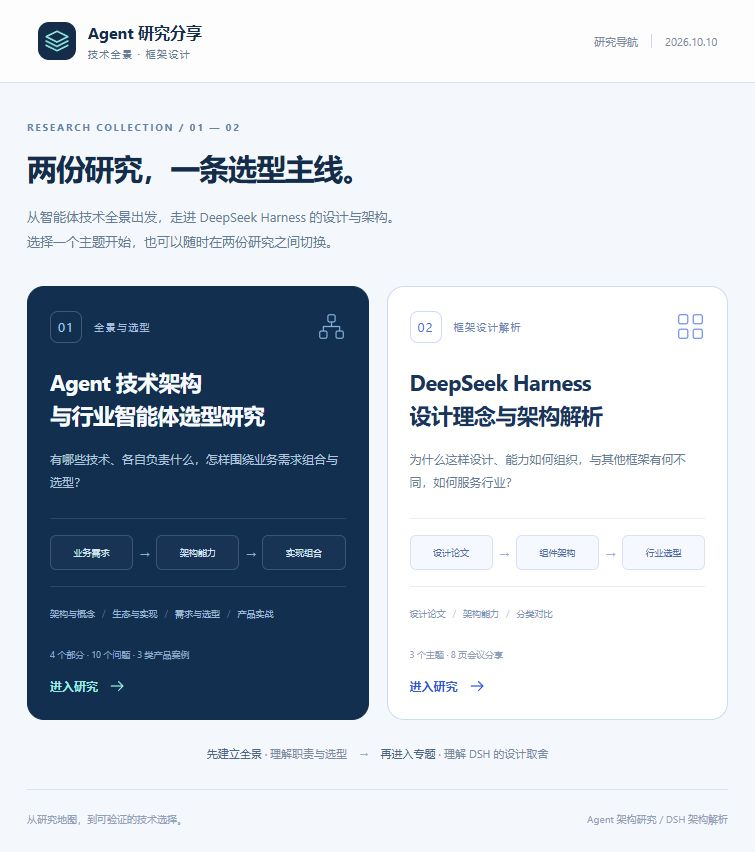

# 智能体架构与行业选型研究

从业务需求出发，理解智能体技术体系，判断系统形态，选择技术组合。

本仓库围绕智能体（Agent，即能够调用工具并根据执行结果推进任务的模型应用）整理架构概念、技术生态、选型方法与行业案例，并提供两份可交互、可离线阅读的研究网页。

其中，智能体执行支架（DeepSeek Harness，简称 DSH）专题聚焦执行底座：它如何组织模型、工具、会话和可组合组件，以及这些设计如何影响技术选型。

适合技术负责人、架构师、产品经理，以及正在设计行业智能体和自然语言问数产品的开发者。问数指通过自然语言查询业务数据，并在必要时进一步分析结果。

## 从哪里开始

下载整个仓库或仓库 ZIP 压缩包，解压后用浏览器打开 `research-share/dist/index.html`。

- 想建立整体认识：先读“Agent 技术架构与行业智能体选型研究”。
- 想了解具体执行底座：再读“DeepSeek Harness 设计理念与架构解析”。
- 想阅读原始材料：查看根目录的两份研究文档，或展开研究网页中的原文附录。

最终网页不需要安装开发环境。正文、图示、样式与交互均内嵌；查看外部参考资料需要联网。请保留 `dist` 中三份网页的文件名和相对位置，以便相互切换。

GitHub 中的网页文件链接用于查看源码；下载后在浏览器打开，才能使用页面交互。



## 仓库里有什么

| 内容 | 主要回答的问题 | 阅读材料 |
| --- | --- | --- |
| 智能体技术架构与行业选型 | 有哪些技术、各自负责什么、如何从需求判断系统形态并选择组合？ | [交互研究网页](research-share/dist/agent-research.html) |
| DeepSeek Harness 设计与架构 | 为什么采用组件组合、如何组织执行能力、如何与其他路线比较？ | [DSH 专题网页](research-share/dist/dsh-meeting.html) |
| 原始研究 | 概念、判断依据和选型讨论的原始记录是什么？ | [技术架构地图与选型备忘录](Agent技术架构地图与行业智能体系统技术选型备忘录_V1_已完成部分冻结版.md) |
| 三类问数产品案例 | 从查询到分析，再到可配置产品，如何划分复用能力与新增工作？ | [产品选型实战](第四部分_三类问数产品选型实战_V1_冻结版.md) |

### 研究一：从技术地图到行业选型

正文分为四部分，包含十个重点问题和三类产品案例；加上导览、结论与资料，共 19 个主题。

1. **架构与概念**：智能体分类、技术职责、适用条件与核心概念边界。
2. **生态与实现**：技术生态、构建与执行路线、多智能体协作和可靠运行。
3. **需求与选型**：系统形态判断、能力组合、实现分工与候选方案验证。
4. **产品选型实战**：查询型、分析型、可配置型问数产品的复用范围、增量交付与验收思路。

粮食行业是贯穿研究的示例；可配置产品部分同时展示零售、制造等行业内容。选型方法从具体业务需求出发。

### 研究二：DeepSeek Harness 专题

专题共八页，围绕三个主题展开：

- **设计出发点**：理解组件在运行过程中的加入、共存与撤出。
- **架构能力**：理解组件职责、依赖关系、服务与资源清理。
- **生态定位与框架对比**：定位技术职责，比较构建与执行路线，并讨论行业选型条件。

## 交互与阅读

- **逐页模式与阅读模式**：适合讲解演示或连续阅读。
- **架构图与关系图**：点击组件或切换场景，查看职责、关系及说明。
- **技术生态对照**：按技术职责查看代表项目，搜索和筛选 31 个项目或比较对象。
- **选型场景**：从业务需求联动系统形态、能力组合与验证任务。
- **问数案例**：切换查询场景、库存变动分析和行业配置示例。
- **手机阅读与浏览器打印**：提供响应式布局与打印样式；尚未生成或验收独立的便携式文档格式（PDF）文件。

详细操作见 [研究网页使用说明](research-share/使用说明.md) 和 [DSH 专题使用说明](research-share/meeting/使用说明.md)。

## 资料时点与验证范围

本版主要资料核对与整理时点为 **2026-10-09 至 2026-10-10**。技术项目会持续变化，具体能力应结合官方资料与目标版本重新核实。

- 本仓库交付研究文档、网页源码及静态交互示意。
- 页面交互在本地演示，没有连接真实模型、业务数据库或企业权限系统；库存分析中的数值为虚构示例。
- 现有验收记录覆盖网页表达、静态资源、链接与部分交互；框架集成、安全、性能和生产环境验证尚未开展。
- 技术职责分类与候选组合体现本研究的分析方法；案例推荐依赖文中给出的业务前提。
- 网页正文是后续整理结果，原始文档与附录保留其历史状态，包括 Q10 的原稿待确认文字。

可复现的静态检查见 [检查脚本](research-share/validate.py)；制作截图和内部验收过程记录保留在本地，不纳入公开仓库。

## 目录结构

```text
.
├── README.md
├── package.json              # 构建依赖与命令
├── package-lock.json         # 固定依赖版本与校验信息
├── Agent技术架构地图与行业智能体系统技术选型备忘录_V1_已完成部分冻结版.md
├── 第四部分_三类问数产品选型实战_V1_冻结版.md
└── research-share/
    ├── dist/                 # 已生成的离线网页与阅读说明
    ├── meeting/              # DSH 专题源码与说明
    ├── foundation.*          # 架构与概念
    ├── ecology.*             # 技术生态与实现
    ├── selection.*           # 需求判断与技术选型
    ├── practice.*            # 三类问数产品案例
    ├── portal.*              # 统一入口
    ├── navigation.*          # 共用导航
    ├── content.html          # 主体内容模板
    ├── style.css / app.js    # 共用样式与交互
    ├── build.mjs             # 网页构建入口
    ├── validate.py           # 静态检查
    └── 使用说明.md
```

## 修改与构建

日常阅读直接使用 `dist` 中的网页。维护内容时修改源文件，再运行构建脚本。

构建需要脚本运行环境（Node.js 20 或更新版本，用于执行构建脚本）与文档渲染库（marked，用于将原始文档转换成网页）。可在仓库根目录执行：

```sh
npm ci
npm run build
```

上述软件包管理工具（npm）随 Node.js 提供。`npm ci` 按锁定文件安装固定版本的依赖；构建脚本使用项目依赖，不依赖制作机器的个人目录。

构建读取根目录两份原始文档，并生成：

```text
research-share/dist/index.html
research-share/dist/agent-research.html
research-share/dist/dsh-meeting.html
```

因此，维护或重新构建时应保留完整仓库目录。

可选静态检查需要 Python 编程语言环境，用于运行检查脚本。在仓库根目录执行：

```sh
npm run check
```

脚本检查主题与页面数量、重复标识、内部与跨页链接、未替换模板内容，以及外部运行资源。浏览器中的交互和显示效果需另外检查。

公开仓库保留可离线阅读的 `dist` 成品和 README 导航截图。其他制作截图、重复压缩包、内部验收记录和本机依赖通过 `.gitignore` 排除。

## 来源与贡献

研究网页中保留官方文档、论文与项目链接，区分原始研究、研究补充和生态示例。欢迎通过 GitHub 问题反馈（Issue，用于报告问题和提出建议）或合并请求（Pull Request，用于提交可审查的修改）纠正术语、更新来源、补充选型条件和可复核的验证结果。

补充框架能力或比较结论时，请提供资料链接、对应版本与核对日期；提交实际验证结果时，请说明任务、运行环境和适用范围。

## 许可证

当前目录尚未配置许可证文件。正式开源发布前，应补充许可证，并明确原创研究内容与网页代码的授权范围；第三方引用内容遵循其原有条款。
